# 数码产品抢购系统

> 🎓 **计算机毕业设计 · 数码产品抢购系统**
>
> 本仓库只放**项目介绍 + 运行截图**（截图是站点带水印的原图，存在仓库 `images/` 里）。
>
> 👉 **完整可运行源码 / 数据库脚本 / 部署文档：[点我获取](https://geekcode.top/archives/%E6%95%B0%E7%A0%81%E4%BA%A7%E5%93%81%E6%8A%A2%E8%B4%AD%E7%B3%BB%E7%BB%9F?utm_source=github)**
>
> 💬 咨询微信：**ir9372**　|　🌐 更多项目：[极客代码 geekcode.top](https://geekcode.top/?utm_source=github)
>
> 📌 项目详情页：<https://geekcode.top/archives/%E6%95%B0%E7%A0%81%E4%BA%A7%E5%93%81%E6%8A%A2%E8%B4%AD%E7%B3%BB%E7%BB%9F?utm_source=github>

<table><td width="230" align="center"> <b>扫码加微信 ir9372</b></td><td valign="middle">📦 源码 = 项目介绍 + 全部运行截图 + 数据库 + 部署文档 👉 点上方任意截图，直接跳到 <b>极客代码 geekcode.top</b> 详情页</td></table>

---

<h1>数码产品抢购系统</h1>
<h2>项目概述</h2>

本项目名为“数码产品抢购系统”，旨在构建一个集商品展示、秒杀抢购、资讯发布及用户交流于一体的综合性电商平台。系统采用前后端分离架构，核心功能涵盖前台用户的商品浏览、分类筛选、参与限时抢购活动、查看商城资讯及论坛互动，以及后台管理员对商品、订单、用户、评论及系统配置的全面管理。该项目适用于数码垂直领域的电商运营场景，通过整合 Shiro 权限控制与 MyBatis-Plus 数据持久层，实现了高效的数据处理与安全管控。目标用户包括普通消费者（前台）和平台运营人员（后台），致力于解决传统电商在促销高峰期并发访问下的稳定性与安全性问题，提供流畅的抢购体验与便捷的管理服务。

<h2>技术架构</h2>
<h3>后端架构</h3>

后端基于 Spring Boot 框架构建，利用其自动配置特性快速搭建应用骨架。数据持久层采用 MyBatis-Plus 结合 MySQL 数据库，MyBatis-Plus 提供了通用的 CRUD 操作接口，显著减少了样板代码的开发量，提升了开发效率。安全认证与授权模块集成 Apache Shiro，负责处理用户登录状态维持、会话管理及细粒度的权限控制，确保系统接口的安全性。Web 层使用 spring-boot-starter-web 提供 RESTful API 支持，配合 commons-lang3 等工具类库处理通用逻辑。

<h3>前端架构</h3>

项目类型为 vue-integrated，表明前端采用 Vue.js 框架进行组件化开发，并通过集成方式与后端交互。前端路由分为前台展示页与后台管理页两套体系，分别对应不同的业务逻辑视图。虽然具体前端路由文件未在上下文中详列，但根据导航菜单可知，前端需实现动态渲染商品列表、抢购倒计时、资讯详情及论坛帖子等功能。

<h3>数据库设计要点</h3>

数据库主要实体包括：商品信息（shangpinxinxi）、商品分类（shangpinfenlei）、抢购活动（miaoshashangpin）、用户信息（yonghu）、商家信息（shangjia）、订单信息（orders）、地址信息（address）、购物车（cart）、论坛帖子（forum）、评论信息（discuss*系列表）及系统配置（config）。各表之间通过外键或业务ID关联，例如订单表关联用户与商品，评论表关联对应的商品或抢购活动，确保数据的一致性与完整性。

<h2>功能模块</h2>
<h3>前台用户端</h3>
<ol>
<li><strong>首页</strong>：展示平台核心入口，聚合热门商品、最新资讯及公告信息。</li>
<li><strong>商品信息</strong>：提供商品列表浏览、按分类筛选、查看详情及加入购物车功能。</li>
<li><strong>抢购活动</strong>：展示限时秒杀商品列表，支持用户参与抢购操作，包含活动状态显示。</li>
<li><strong>商城资讯</strong>：发布平台新闻、优惠活动通知及行业文章，支持列表查看与详情阅读。</li>
<li><strong>交流论坛</strong>：提供用户发帖、回帖功能，增强社区互动性。</li>
<li><strong>个人中心</strong>：虽无独立菜单项，但通过截图可知具备收藏列表、个人信息维护、我的订单查看及收货地址管理功能。</li>
<li><strong>关于我们</strong>：展示平台简介及联系方式。</li>
</ol>
<h3>后台管理端</h3>
<ol>
<li><strong>仪表盘/首页</strong>：展示关键业务数据统计概览。</li>
<li><strong>用户管理</strong>：对注册用户进行增删改查，重置密码及状态管理。</li>
<li><strong>商家管理</strong>：审核并管理入驻商家的基本信息。</li>
<li><strong>商品管理</strong>：<ul>
<li><strong>商品分类</strong>：维护商品的层级分类结构。</li>
<li><strong>商品信息</strong>：上架、下架、编辑商品详情、库存及价格。</li>
<li><strong>抢购活动</strong>：创建和管理秒杀活动，设置活动时间、数量及关联商品。</li>
</ul>
</li>
<li><strong>订单管理</strong>：查看所有订单状态，处理发货、退款及订单查询。</li>
<li><strong>内容管理</strong>：<ul>
<li><strong>商城资讯</strong>：发布、编辑和删除新闻资讯。</li>
<li><strong>关于我们</strong>：维护平台介绍页面内容。</li>
</ul>
</li>
<li><strong>评论管理</strong>：<ul>
<li><strong>抢购活动评论</strong>：审核与管理用户对秒杀活动的反馈。</li>
<li><strong>商品信息评论</strong>：审核与管理用户对普通商品的点评。</li>
</ul>
</li>
<li><strong>论坛管理</strong>：监控论坛帖子，处理违规内容。</li>
<li><strong>系统配置</strong>：修改网站名称、Logo、轮播图等全局参数。</li>
</ol>
<h2>用户角色与权限</h2>

根据代码中的 Controller 列表及 Shiro 集成情况，系统主要涉及两类角色：普通用户（含买家与卖家身份隐含于数据表中）和超级管理员。

<table>
<thead>
<tr>
<th align="left">角色</th>
<th align="left">可访问功能模块</th>
<th align="left">权限描述</th>
</tr>
</thead>
<tbody><tr>
<td align="left"><strong>普通用户</strong></td>
<td align="left">首页、商品信息、抢购活动、商城资讯、交流论坛、个人中心（收藏、订单、地址、评论）</td>
<td align="left">仅拥有前台浏览、下单、参与抢购、发帖、评论及查看个人数据的权限。无法访问任何后台管理接口。</td>
</tr>
<tr>
<td align="left"><strong>管理员</strong></td>
<td align="left">所有后台路由（/news, /aboutus, /discussmiaoshashangpin, /yonghu, /shangpinfenlei, /miaoshashangpin, /discussshangpinxinxi, /shangpinxinxi, /orders/:status, /config, /shangjia, /forum）</td>
<td align="left">拥有最高权限，可对全系统数据进行 CRUD 操作，包括用户管理、商品上下架、订单处理、内容发布、评论审核及系统配置修改。</td>
</tr>
</tbody></table>

<em>注：系统中存在 <code>shangjia</code> (商家) 相关表和控制器，但在提供的后台路由中未明确区分独立的“商家后台”入口，通常此类系统在中小型毕设中由管理员代为管理或商家作为特殊类型用户存在，此处依据现有路由归入管理员视角或基础用户数据范畴。</em>

<h2>项目特色与创新点</h2>
<ol>
<li><strong>秒杀场景专项优化</strong>：区别于普通电商系统，本项目专门设计了“抢购活动”模块（MiaoshashangpinController），针对高并发下的库存扣减与订单生成进行了逻辑隔离，体现了对瞬时流量处理的关注。</li>
<li><strong>多维度的内容互动生态</strong>：不仅包含传统的商品交易，还集成了“交流论坛”与“商城资讯”，构建了从“看资讯-逛商品-抢优惠-聊心得”的完整闭环，增强了用户粘性。</li>
<li><strong>精细化评论管理体系</strong>：将评论划分为“抢购活动评论”与“商品信息评论”两个独立维度进行管理，有助于运营人员更精准地分析不同营销环节的用户反馈。</li>
<li><strong>基于 Shiro 的安全架构</strong>：引入 Apache Shiro 而非简单的拦截器，实现了更灵活的认证与会话管理，为后续扩展 RBAC（基于角色的访问控制）奠定了坚实基础。</li>
</ol>
<h2>部署环境</h2>

为确保“数码产品抢购系统”正常运行，需准备以下软件环境：

<ol>
<li><strong>Java 运行环境</strong>：JDK 1.8 或以上版本（推荐 JDK 1.8_202+，以兼容 Spring Boot 2.x 常见版本）。</li>
<li><strong>数据库服务</strong>：MySQL 5.7 或 MySQL 8.0，需初始化相应的表结构及基础数据。</li>
<li><strong>后端构建工具</strong>：Maven 3.6+，用于依赖管理与项目打包。</li>
<li><strong>前端运行环境</strong>：Node.js 12+ 及 npm/yarn，用于编译 Vue 前端资源。</li>
<li><strong>Web 服务器</strong>：内置 Tomcat（Spring Boot 默认集成）或外部 Nginx（用于静态资源托管及反向代理）。</li>
<li><strong>浏览器</strong>：Chrome、Edge 或 Firefox 等现代主流浏览器，用于访问前台与后台界面。</li>
</ol>
<h2>五、技术特性</h2>
<ul>
<li>前后端集成部署，前端资源打包至后端 static 目录</li>
<li>使用 MyBatis-Plus 简化数据访问层开发</li>
<li>集成 Shiro 权限框架实现角色权限控制</li>
</ul>
<h2>六、功能模块截图</h2>
<h3>前台用户端</h3>
<h4>前台-抢购活动列表</h4>

<a href="https://geekcode.top/archives/%E6%95%B0%E7%A0%81%E4%BA%A7%E5%93%81%E6%8A%A2%E8%B4%AD%E7%B3%BB%E7%BB%9F?utm_source=github" title="查看完整源码">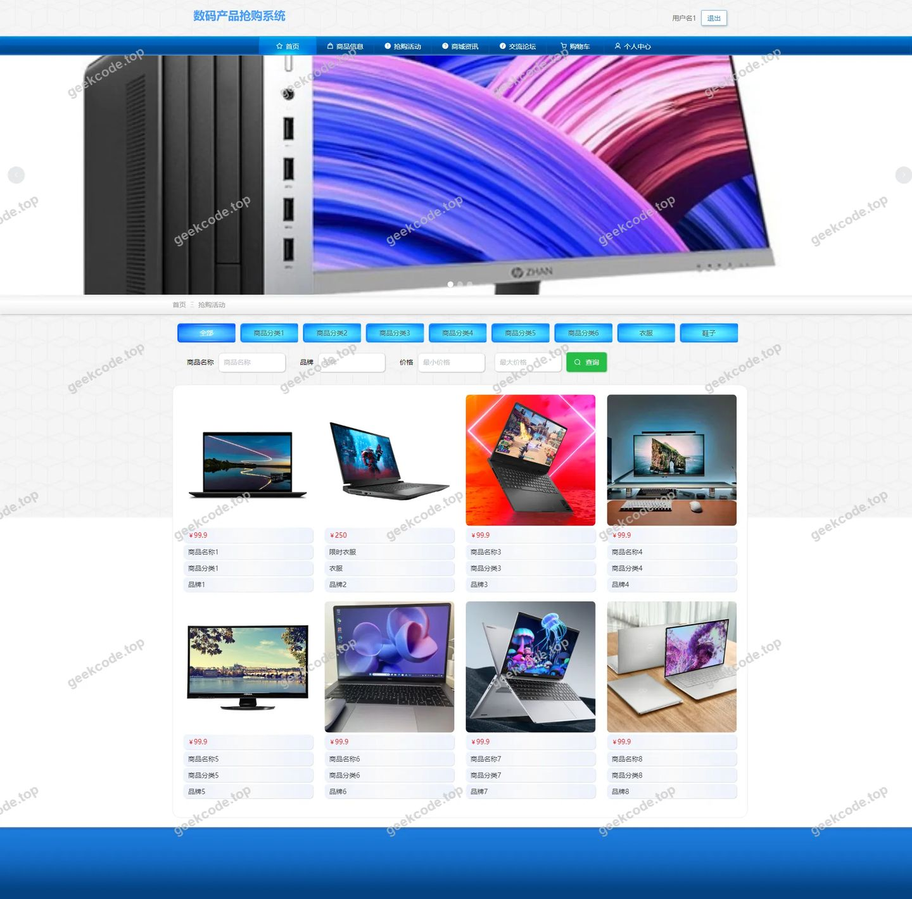</a>

<h4>前台-商家列表</h4>

<a href="https://geekcode.top/archives/%E6%95%B0%E7%A0%81%E4%BA%A7%E5%93%81%E6%8A%A2%E8%B4%AD%E7%B3%BB%E7%BB%9F?utm_source=github" title="查看完整源码">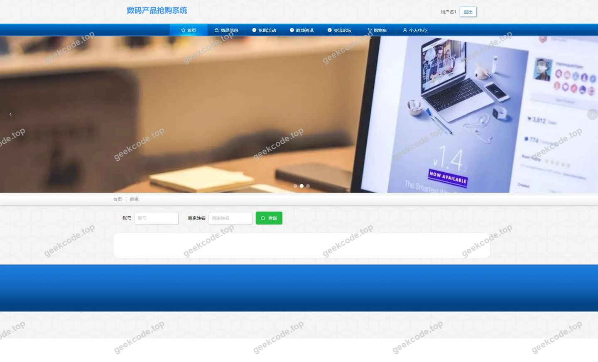</a>

<h4>前台-商品分类列表</h4>

<a href="https://geekcode.top/archives/%E6%95%B0%E7%A0%81%E4%BA%A7%E5%93%81%E6%8A%A2%E8%B4%AD%E7%B3%BB%E7%BB%9F?utm_source=github" title="查看完整源码">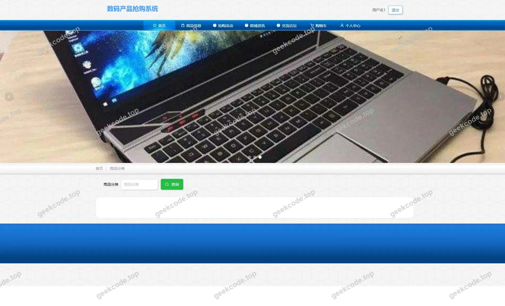</a>

<h4>前台-商品信息列表</h4>

<a href="https://geekcode.top/archives/%E6%95%B0%E7%A0%81%E4%BA%A7%E5%93%81%E6%8A%A2%E8%B4%AD%E7%B3%BB%E7%BB%9F?utm_source=github" title="查看完整源码">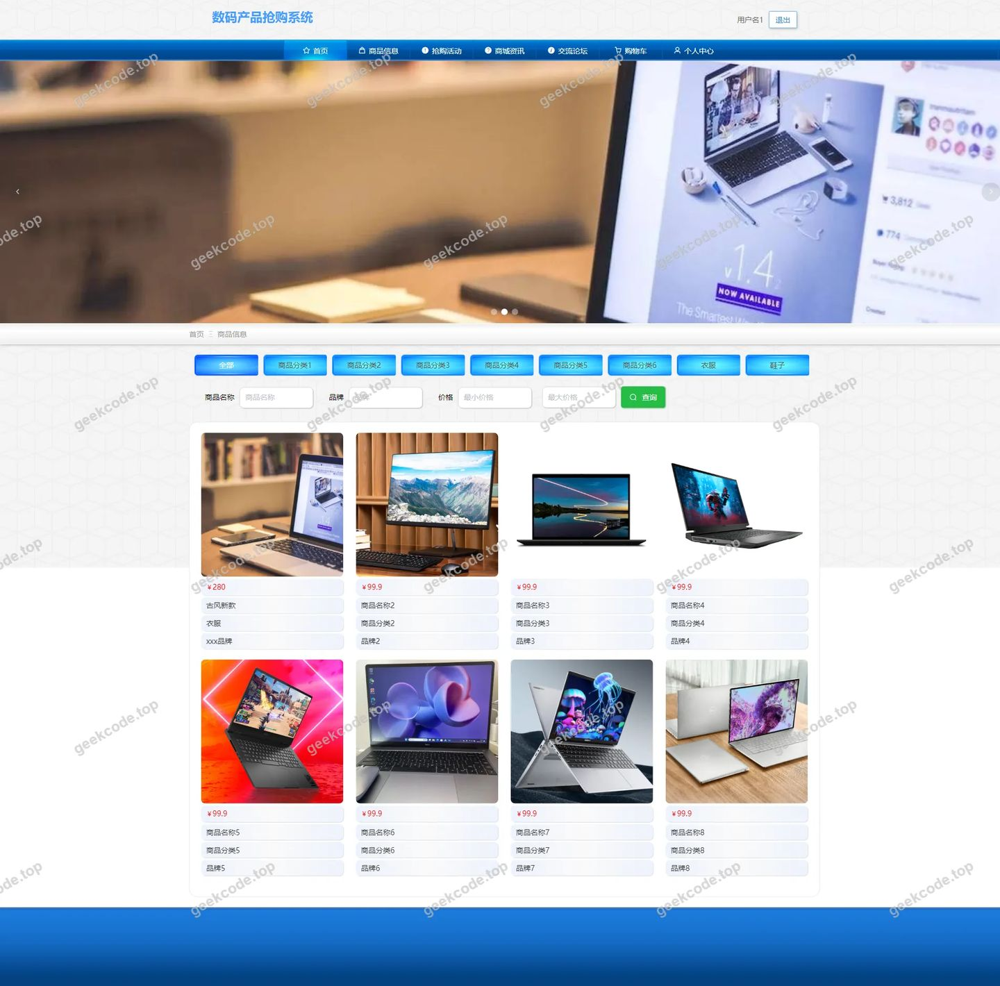</a>

<h4>前台-收藏列表</h4>

<a href="https://geekcode.top/archives/%E6%95%B0%E7%A0%81%E4%BA%A7%E5%93%81%E6%8A%A2%E8%B4%AD%E7%B3%BB%E7%BB%9F?utm_source=github" title="查看完整源码">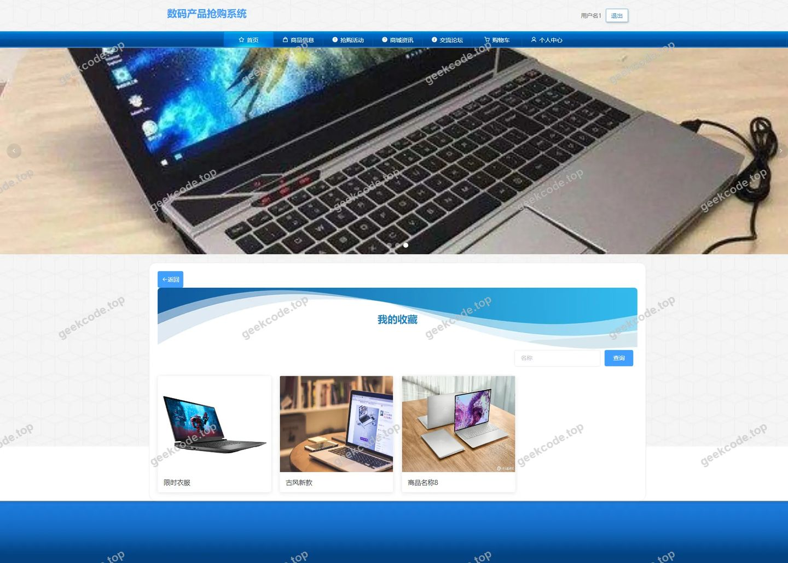</a>

<h4>前台-个人中心</h4>

<a href="https://geekcode.top/archives/%E6%95%B0%E7%A0%81%E4%BA%A7%E5%93%81%E6%8A%A2%E8%B4%AD%E7%B3%BB%E7%BB%9F?utm_source=github" title="查看完整源码">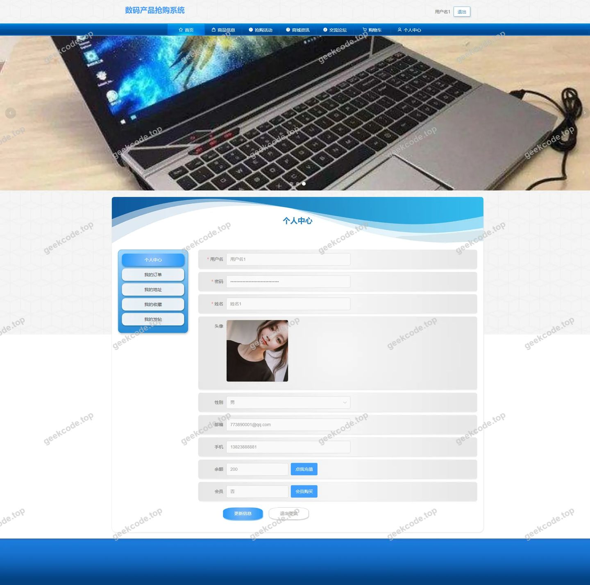</a>

<h4>前台-公告列表</h4>

<a href="https://geekcode.top/archives/%E6%95%B0%E7%A0%81%E4%BA%A7%E5%93%81%E6%8A%A2%E8%B4%AD%E7%B3%BB%E7%BB%9F?utm_source=github" title="查看完整源码">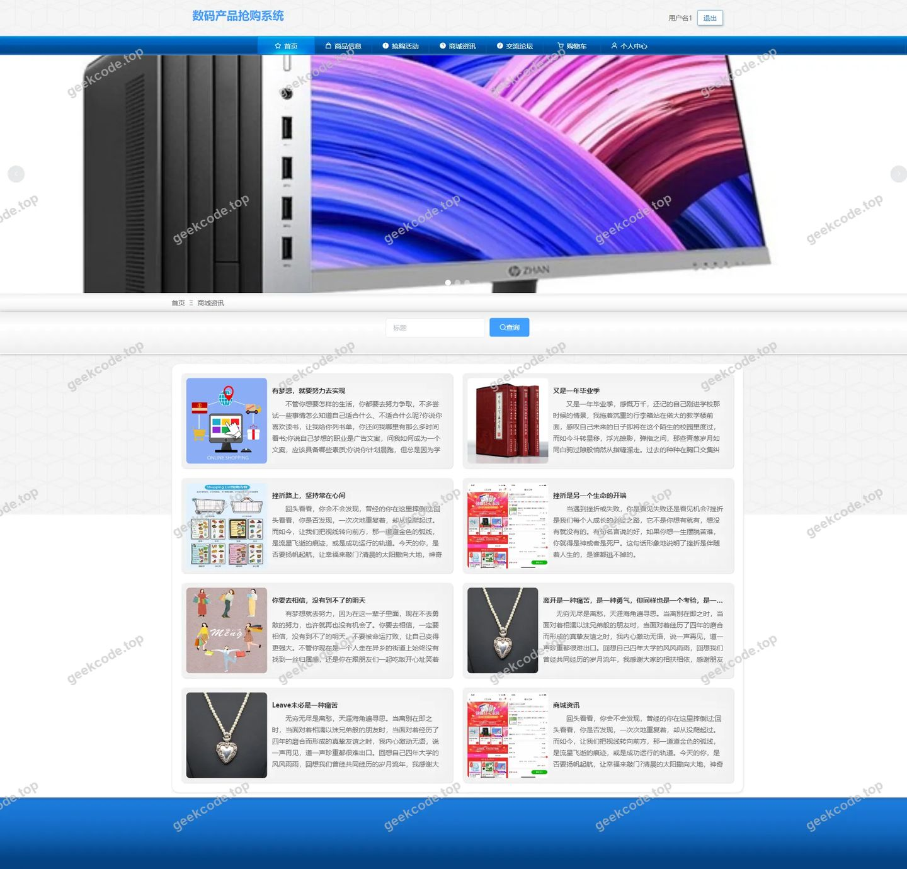</a>

<h3>后台管理端</h3>
<h4>后台-登录页</h4>

<h4>后台-订单管理</h4>

<a href="https://geekcode.top/archives/%E6%95%B0%E7%A0%81%E4%BA%A7%E5%93%81%E6%8A%A2%E8%B4%AD%E7%B3%BB%E7%BB%9F?utm_source=github" title="查看完整源码">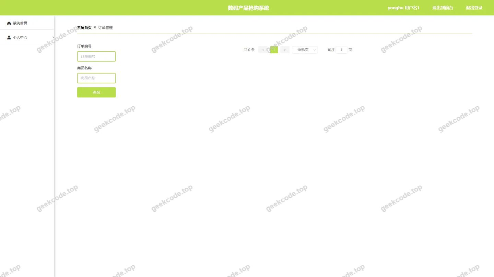</a>

<h4>后台-关于我们</h4>

<a href="https://geekcode.top/archives/%E6%95%B0%E7%A0%81%E4%BA%A7%E5%93%81%E6%8A%A2%E8%B4%AD%E7%B3%BB%E7%BB%9F?utm_source=github" title="查看完整源码">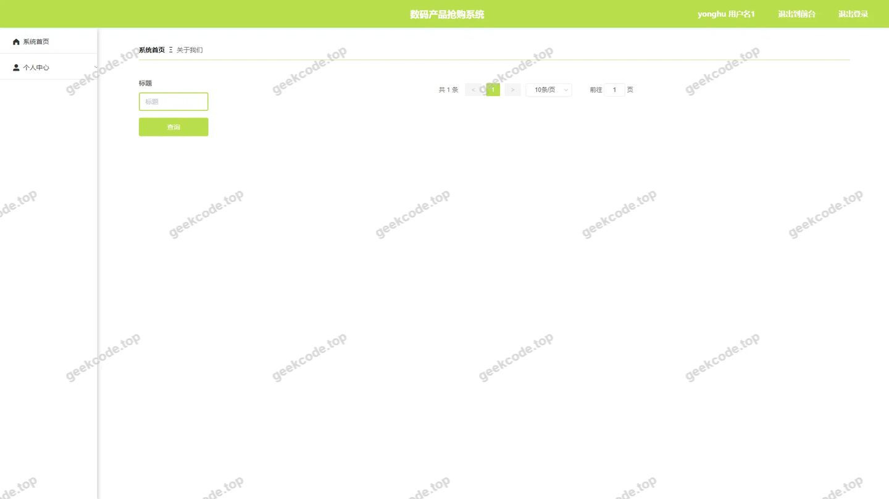</a>

<h4>后台-抢购活动</h4>

<a href="https://geekcode.top/archives/%E6%95%B0%E7%A0%81%E4%BA%A7%E5%93%81%E6%8A%A2%E8%B4%AD%E7%B3%BB%E7%BB%9F?utm_source=github" title="查看完整源码">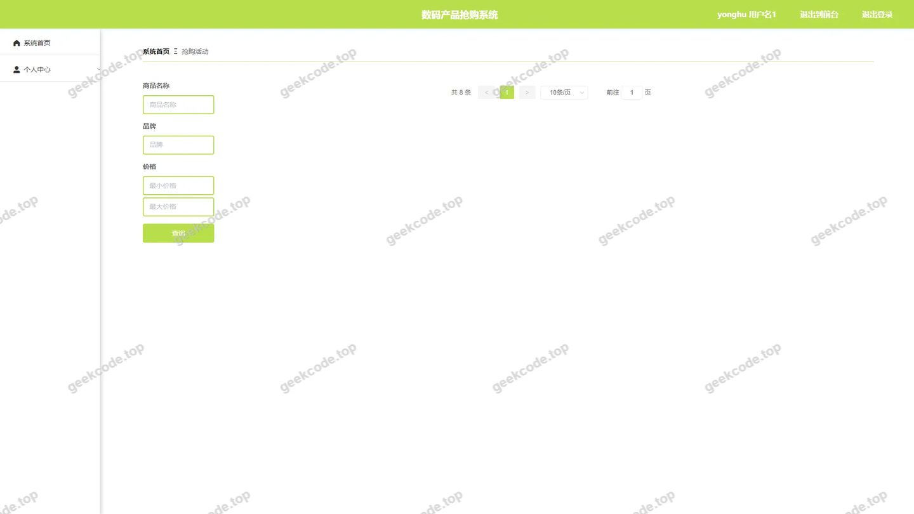</a>

<h4>后台-抢购活动评论</h4>

<a href="https://geekcode.top/archives/%E6%95%B0%E7%A0%81%E4%BA%A7%E5%93%81%E6%8A%A2%E8%B4%AD%E7%B3%BB%E7%BB%9F?utm_source=github" title="查看完整源码">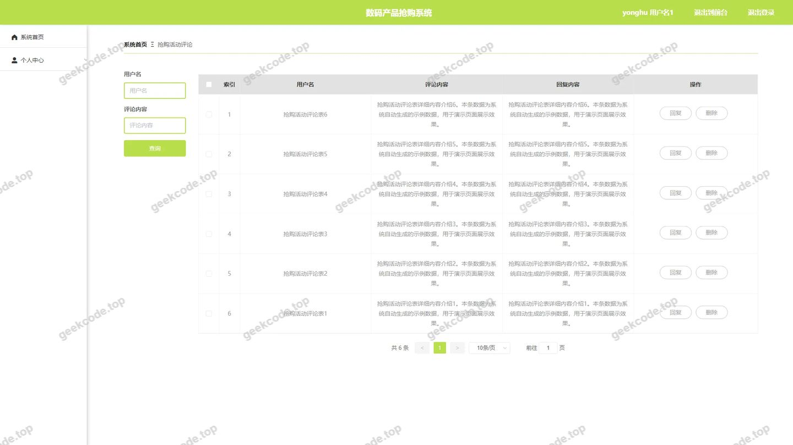</a>

<h4>后台-商城资讯</h4>

<h4>后台-商品分类</h4>

<a href="https://geekcode.top/archives/%E6%95%B0%E7%A0%81%E4%BA%A7%E5%93%81%E6%8A%A2%E8%B4%AD%E7%B3%BB%E7%BB%9F?utm_source=github" title="查看完整源码">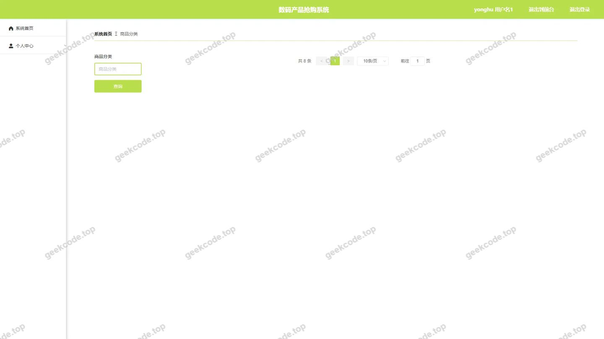</a>

<h4>后台首页</h4>

<a href="https://geekcode.top/archives/%E6%95%B0%E7%A0%81%E4%BA%A7%E5%93%81%E6%8A%A2%E8%B4%AD%E7%B3%BB%E7%BB%9F?utm_source=github" title="查看完整源码">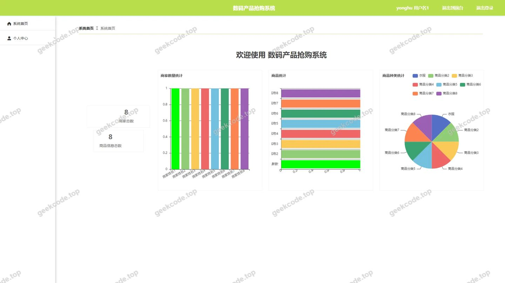</a>

<h4>后台-用户</h4>

<a href="https://geekcode.top/archives/%E6%95%B0%E7%A0%81%E4%BA%A7%E5%93%81%E6%8A%A2%E8%B4%AD%E7%B3%BB%E7%BB%9F?utm_source=github" title="查看完整源码">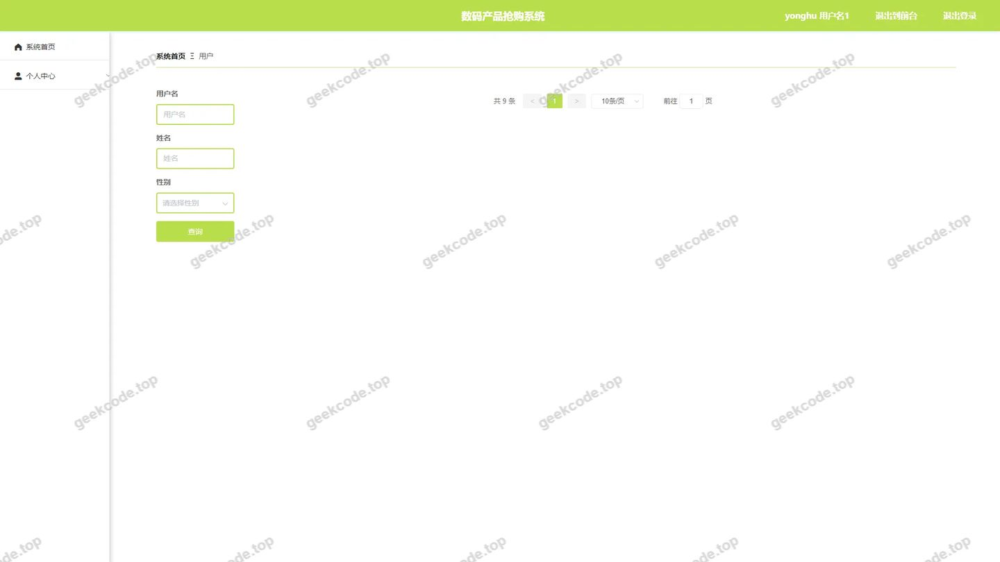</a>

---

## 获取完整源码

| 项目 | 说明 |
| --- | --- |
| 项目名 | 数码产品抢购系统 |
| 运行截图 | 本文 16 张（站点带水印原图，仓库 `images/` 目录） |
| 完整源码 | [https://geekcode.top/archives/%E6%95%B0%E7%A0%81%E4%BA%A7%E5%93%81%E6%8A%A2%E8%B4%AD%E7%B3%BB%E7%BB%9F?utm_source=github](https://geekcode.top/archives/%E6%95%B0%E7%A0%81%E4%BA%A7%E5%93%81%E6%8A%A2%E8%B4%AD%E7%B3%BB%E7%BB%9F?utm_source=github) |
| 咨询微信 | **ir9372**（备注：jingpin-yuanma） |
| 更多项目 | [极客代码 geekcode.top](https://geekcode.top/?utm_source=github) |

> 需要源码、部署、改配置、跑不起来等问题，加微信 ir9372 沟通，说明项目名即可。
